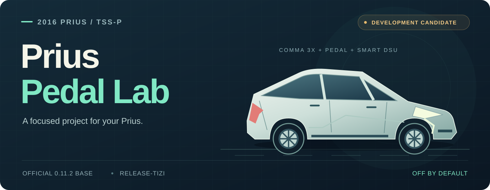

  

# Prius Pedal Lab

**A focused development fork for the 2016 Toyota Prius with Toyota Safety Sense P.**

comma 3X · comma Pedal · Smart DSU

[**2016 Prius owner guide**](docs/PRIUS_2016_OWNER_GUIDE.md) · [How it works](docs/PRIUS_PEDAL.md) · [Validation](#validation) · [Changelog](CHANGELOG.md)

> [!IMPORTANT]
> **Development candidate — hardware validation is still pending.** The software tests and firmware build pass, but this project has not been qualified in the car. The inherited prebuilt firmware does not contain the new Pedal safety mode. A matching firmware build and bootstub/signature checks are required before stationary hardware validation; installing this branch alone is incomplete.

## Made for this Prius setup

If you own a **2016 Prius with Toyota Safety Sense P**, start here. Model year alone is not enough: this port requires the correct factory driver-assistance equipment and both additional devices.

| Part of your setup | This project targets |
| --- | --- |
| **Car** | 2016 Toyota Prius with factory **Toyota Safety Sense P (TSS-P)** |
| **Device** | **comma 3X**, using the `release-tizi` software base and AGNOS 19.9 |
| **Pedal** | A physically fitted **comma Pedal / gas interceptor** |
| **DSU** | A fitted **Smart DSU (SDSU)** |
| **Activation** | Off by default; both devices must be detected and alpha longitudinal control explicitly enabled |

This path is limited to the TSS-P `TOYOTA_PRIUS` platform. Prius v, later TSS2 Prius models, cars without TSS-P, and stock/disconnected DSU configurations do not activate it. The platform also groups some later Prius/Prime years; this project's owner documentation and hardware-validation target are the **2016 Prius**.

**[Check your setup and current readiness →](docs/PRIUS_2016_OWNER_GUIDE.md)**

## A little help when moving off

The port adapts FrogPilot's Prius-specific Pedal behavior to the official software base:

- **Launch assist from standstill.** A fixed Pedal command is available when longitudinal control is active and the planner requests positive acceleration. Assist ends when the vehicle moves.
- **Driver override.** Pressing the accelerator, pressing the brake, or cancelling disables Pedal assist. Physical accelerator sensor readings distinguish your foot from the interceptor's own output.
- **Healthy hardware required.** Faults, invalid packets, or stale Pedal/SDSU data block nonzero actuation. The firmware independently enforces the Pedal command limits.
- **The Toyota ACC path remains.** Ongoing acceleration and braking use the existing Toyota ACC commands and limits. The Pedal is used for the bounded standstill assist.

The implementation also carries over the Prius/Pedal standstill-request behavior and the SDSU follow-distance button input. Steering limits and driver monitoring are retained.

[Read the control behavior and source map →](docs/PRIUS_PEDAL.md#implemented-behavior)

## Start with the right guide

| You want to… | Read this |
| --- | --- |
| Understand whether your 2016 Prius has the required setup | [2016 Prius owner guide](docs/PRIUS_2016_OWNER_GUIDE.md) |
| See exactly what changed and where the code lives | [Implementation and FrogPilot source map](docs/PRIUS_PEDAL.md) |
| Reproduce tests or build the bench firmware artifact | [Validation and build instructions](docs/PRIUS_PEDAL.md#validation-and-build) |
| See what has been added to the fork | [Changelog](CHANGELOG.md) |
| Read the original project's setup and data-policy documentation | [Upstream README at the pinned release](https://github.com/commaai/openpilot/blob/f7db927c728bab57bb1263e05465766a8f28fc9d/README.md) |

## Validation

The automated workflow runs Toyota integration tests, CAN regression tests, the full safety suite, safety coverage, and an STM32H7 firmware build.

| Check | Recorded result |
| --- | --- |
| **Full safety suite** | 3,222 tests run, including 394 inherited skips; no failures |
| **CAN parser / packer** | 49 tests passed |
| **Safety line coverage** | 100%; all 190 functions covered locally |
| **Panda firmware** | STM32H7 build passed locally and on GitHub Actions |
| **In-car acceptance** | **Pending** — software evidence does not establish physical vehicle behavior |

**[View the latest validation runs →](https://github.com/groxaxo/prius-pedal/actions/workflows/prius-pedal.yml)**

Each successful run retains a bench firmware artifact and a manifest with its source commit and SHA-256 hashes for 14 days. The image uses the upstream public debug test key; it is not an official release signature. See the [firmware requirements](docs/PRIUS_PEDAL.md#delivery-boundary).

## Branches and the official baseline

| Reference | Purpose |
| --- | --- |
| **`release-tizi`** | Main branch of **this fork**, with the Prius Pedal changes merged in |
| **`prius-pedal-candidate`** | Development branch for changes before merging |
| **`upstream-release-tizi-0.11.2`** | Frozen baseline branch at the unchanged official release |

The official base is **commaai/openpilot 0.11.2**, commit [`f7db927`](https://github.com/commaai/openpilot/commit/f7db927c728bab57bb1263e05465766a8f28fc9d). The fork's `release-tizi` branch contains custom changes and is separate from comma's official branch of the same name. Merging here does not install software on a comma device.

GitHub places this repository in the existing openpilot fork network and displays `dragonpilot/dragonpilot` as its immediate parent. The delivered code starts directly from the pinned official commaai release above.

## Built on open source

This project builds on [commaai/openpilot](https://github.com/commaai/openpilot/tree/f7db927c728bab57bb1263e05465766a8f28fc9d) and adapts the Prius Pedal behavior from [FrogPilot](https://github.com/FrogAi/FrogPilot/tree/8955eaae9574c2a9723f401bdbaf120bf021d08a). Source references and attribution are recorded in the [implementation guide](docs/PRIUS_PEDAL.md#what-frogpilot-uses-for-a-2016-prius).

The original MIT license and copyright notices are retained. Some components have their own licenses. See [LICENSE](LICENSE), the [upstream safety requirements](docs/SAFETY.md), and the [original README on the frozen baseline](https://github.com/groxaxo/prius-pedal/blob/upstream-release-tizi-0.11.2/README.md).
